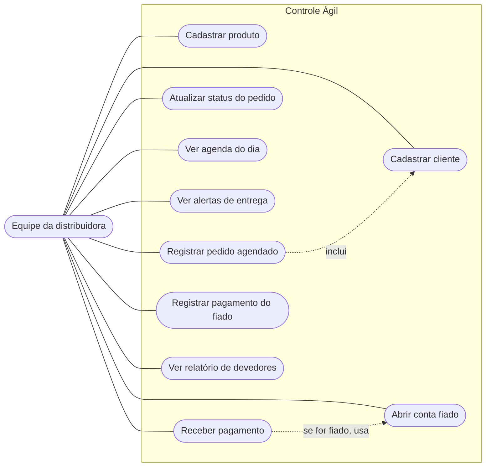

# Casos de uso: Controle Ágil (Etapa 1)

Quem usa o sistema é a equipe da distribuidora (atendimento e caixa). O cliente final não acessa o sistema: os pedidos continuam chegando pelo WhatsApp e a equipe os registra.

| Caso de uso | Requisitos | Classes envolvidas |
|-------------|------------|--------------------|
| Cadastrar cliente | RF01 | `Cliente`, `ClienteRepository`, `ClientesController` |
| Cadastrar produto | RF02 | `Produto`, `ProdutoRepository` |
| Registrar pedido agendado | RF03 | `Pedido`, `ItemPedido`, `PedidoService` |
| Atualizar status do pedido | RF04 | `Pedido`, `StatusPedido` |
| Ver agenda do dia | RF05 | `PedidoService.agendaDoDia()` |
| Ver alertas de entrega | RF06 | `PedidoService.entregasProximas()` |
| Abrir conta fiado | RF07 | `Cliente.abrirContaFiado()`, `ContaFiado` |
| Receber pagamento | RF12 | `Pagamento`, `PagamentoDinheiro`, `PagamentoPix`, `PagamentoFiado` |
| Registrar pagamento do fiado | RF08, RF09, RF11 | `ContaFiado`, `MovimentacaoFiado` |
| Ver relatório de devedores | RF10 | `FiadoService`, `Devedor` |
