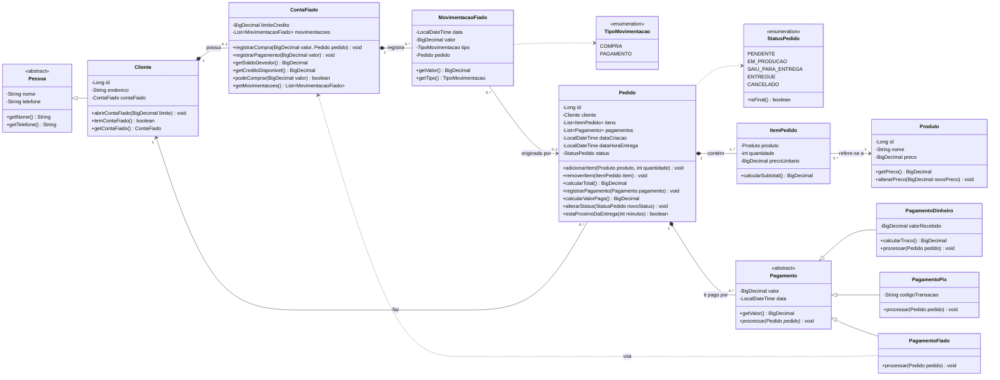

# Diagrama de classes: Controle Ágil (Etapa 1)

Modelo de domínio do MVP (pedidos agendados + conta fiado). O código fica em
[`src/main/java/br/com/controleagil/model`](../../src/main/java/br/com/controleagil/model).

`Entrega` e `Entregador` são da **Etapa 2** e ainda não estão no código.

## Regras de negócio no código

| Regra | Onde |
|-------|------|
| Todo pedido nasce `PENDENTE` e precisa de data e hora de entrega | `Pedido` (construtor) |
| Itens só mudam enquanto o pedido está `PENDENTE` | `Pedido.adicionarItem` / `removerItem` |
| Status só anda para frente; `CANCELADO` vale em qualquer etapa não final | `Pedido.alterarStatus` |
| Não se paga mais do que falta pagar, nem pedido cancelado | `Pedido.registrarPagamento` |
| Pedidos atrasados também aparecem no alerta de entrega próxima | `Pedido.estaProximoDaEntrega` |
| O preço do item é o do momento da venda | `ItemPedido` (construtor) |
| Saldo devedor é calculado pelas movimentações, nunca alterado direto | `ContaFiado.getSaldoDevedor` |
| Compra fiado não pode passar do limite de crédito | `ContaFiado.registrarCompra` |
| Pagamento do fiado não pode ser maior que a dívida | `ContaFiado.registrarPagamento` |
| Fiado só para cliente com conta fiado aberta | `PagamentoFiado.processar` |
| Dinheiro: valor recebido precisa cobrir o pagamento | `PagamentoDinheiro.processar` |
| Pix: precisa do código da transação | `PagamentoPix.processar` |
