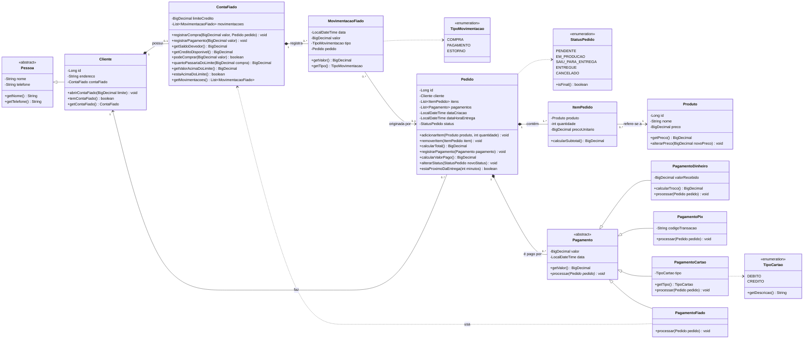

# Diagrama de classes: Controle Ágil (Etapa 1)

Modelo de domínio do MVP (pedidos agendados + conta fiado). O código fica em
[`src/main/java/br/com/controleagil/model`](../../src/main/java/br/com/controleagil/model).

`Entrega` e `Entregador` são da **Etapa 2** e ainda não estão no código.

## Regras de negócio no código

Os códigos (RN e RC) são os de [`docs/requisitos/requisitos.md`](../requisitos/requisitos.md).
Toda regra quebrada lança `RegraNegocioException`, com mensagem em português.

| Código | Regra | Onde |
|--------|-------|------|
| RN01 | Todo pedido precisa de data e hora de entrega | `Pedido` (construtor) |
| RN02 | Pedido precisa de pelo menos um item para ser salvo | `PedidoService.registrarPedido` |
| RN03 | Compra fiado acima do limite não é bloqueada: a tela avisa e pede confirmação | `ContaFiado.podeComprar` e `quantoPassariaDoLimite` (usados pelas telas) |
| RN04 | Pagamento do fiado não pode ser maior que a dívida, nem zero ou negativo | `ContaFiado.registrarPagamento` |
| RN05 | Pedido entregue ou cancelado não muda mais de status | `Pedido.alterarStatus` usando `StatusPedido.isFinal` |
| RC01 | Todo pedido nasce `PENDENTE` | `Pedido` (construtor) |
| RC02, RC03 | Status avança em ordem, um passo por vez; `CANCELADO` vale em qualquer etapa não final | `Pedido.alterarStatus`, `StatusPedido.proximo` |
| RC04 | Itens só mudam enquanto o pedido está `PENDENTE` | `Pedido.adicionarItem` / `removerItem` |
| RC05 | O preço do item é o do momento da venda | `ItemPedido` (construtor) |
| RC07 | Não se paga mais do que falta pagar, nem pedido cancelado | `Pedido.registrarPagamento` |
| RC08 | Saldo devedor é calculado pelas movimentações, nunca alterado direto | `ContaFiado.getSaldoDevedor` |
| RC09 | Fiado só para cliente com conta fiado aberta | `PagamentoFiado.processar` |
| RC10 | Dinheiro: valor recebido precisa cobrir o pagamento | `PagamentoDinheiro.processar` |
| RC11 | Pix: código da transação opcional; se vier, precisa ter formato válido | `PagamentoPix.processar` |
| RC18 | Cartão: precisa dizer se foi débito ou crédito | `PagamentoCartao.processar` |
| RC12 | Pedido novo não pode ter entrega no passado | `PedidoService.registrarPedido` |
| – | Pedidos atrasados também aparecem no alerta de entrega próxima | `Pedido.estaProximoDaEntrega` |

## Classes de apoio

O diagrama acima mostra só o **domínio** (pacote `model`). Para o sistema funcionar com telas e
camadas, entraram também as classes abaixo. Elas não mudam o diagrama: ficam em volta dele.

### Exceção

| Classe | Pacote | Por que existe |
|--------|--------|----------------|
| `RegraNegocioException` | `exception` | Diferencia "regra de negócio quebrada" (mensagem amigável na tela) de "erro inesperado" (bug: aviso genérico e detalhes no console). Herda de `RuntimeException`. |

### Repositórios (onde os objetos ficam guardados)

| Classe | Pacote | Por que existe |
|--------|--------|----------------|
| `ClienteRepository`, `ProdutoRepository`, `PedidoRepository` | `repository` | **Interfaces**: dizem *o que* dá para fazer (salvar, buscar, listar), sem dizer *como*. Os services só conhecem as interfaces. |
| `ClienteRepositoryMemoria`, `ProdutoRepositoryMemoria`, `PedidoRepositoryMemoria` | `repository.memoria` | Guardam os objetos na memória (somem ao fechar). Usados nos testes. Geram os ids com `AtomicLong`; o id do pedido é o número do pedido. |
| `ClienteRepositorySqlite`, `ProdutoRepositorySqlite`, `PedidoRepositorySqlite` | `repository.sqlite` | Guardam tudo no SQLite (`controle-agil.db`): clientes com o limite e o histórico do fiado, produtos, pedidos com itens (preço da época) e pagamentos. Na abertura leem tudo para a memória (um "cache"); cada `salvar()` grava no banco, numa transação, e atualiza o cache. Assim todas as telas usam os mesmos objetos. |
| `ConexaoBanco`, `BancoSqlite`, `RepositorioException` | `repository.sqlite` | `ConexaoBanco` abre conexões, cria as tabelas e roda gravações em transação (ou grava tudo, ou nada). `BancoSqlite` monta os três repositórios na ordem certa (clientes e produtos, depois pedidos, depois o histórico do fiado, que aponta para os pedidos). |
| `Repositorios` *(record)* | `repository` | Junta os três repositórios num objeto só, para o `AppContexto` receber "os repositórios" sem saber se são do SQLite ou da memória. |

### Services (os casos de uso)

| Classe | Por que existe |
|--------|----------------|
| `ClienteService` | Cadastrar, editar, buscar (sem ligar para acentos) e abrir conta fiado. |
| `ProdutoService` | Cadastrar e editar produtos; confere nome e preço antes de mudar, para o produto nunca ficar "pela metade". |
| `PedidoService` | Registrar pedido (RN02, entrega no passado), pagamentos, avanço de status e as consultas da agenda ("Em breve", "Atrasado"). Recebe um `Clock` (relógio) para os testes controlarem "que horas são". Quando há pagamento, salva também o cliente (no fiado, a conta dele muda). |
| `FiadoService` | O que olha para várias contas: lista de contas, total a receber, relatório de devedores e pagamento da dívida. |
| `FormaPagamento` *(enum)* | As opções de pagamento que a tela mostra. O `PedidoService.criarPagamento()` transforma a opção na subclasse certa de `Pagamento` (o único lugar com esse "if"). |
| `Devedor` *(record)* | Uma linha do relatório de devedores: cliente, saldo e desde quando deve. |
| `DadosExemplo` | Dados **fictícios** carregados na abertura, sempre pelos services (as regras valem para eles também). |

### Telas e utilitários

| Classe | Pacote | Por que existe |
|--------|--------|----------------|
| `AppContexto` | `util` | Cria repositórios e services **uma vez** e entrega aos controllers pela `controllerFactory` do `FXMLLoader` (injeção de dependência). Assim todas as telas usam os mesmos dados. |
| `Formatador` | `util` | R$ no padrão brasileiro, datas `dd/MM/yyyy`, horas `HH:mm`, data por extenso e leitura dos valores digitados. |
| `Dialogos` | `util` | Avisos padronizados e o tratamento de erros das telas (`tentar()`). |
| `PrincipalController`, `Tela`, `Navegacao`, `TelaAtualizavel` | `controller` | Menu lateral e troca de telas. `Navegacao` e `TelaAtualizavel` são interfaces: as telas pedem "abra a Agenda" sem conhecer a janela principal, e a Agenda/Início se atualizam com o relógio. |
| `InicioController`, `AgendaController`, `NovoPedidoController`, `ClientesController`, `ProdutosController`, `FiadoController` | `controller` | Uma por tela. São "finas": só chamam os services e mostram o resultado. |
| `PagamentoDialogo`, `DetalhesPedidoDialogo`, `Etiquetas`, `Tabelas` | `controller` | Diálogos da Agenda, as etiquetas coloridas de status (sempre com texto) e o ajuste comum das tabelas (sem ordenar por clique no cabeçalho). |

### Métodos que não estão no diagrama

| Método | Por que existe |
|--------|----------------|
| `StatusPedido.proximo()` | Diz para qual status o pedido avança. Com ele, o status só anda em ordem, sem pular etapas, e a tela mostra "Avançar para Em produção". |
| `StatusPedido.getDescricao()`, `TipoMovimentacao.getDescricao()` | Nome bonito para a tela ("Em produção" em vez de `EM_PRODUCAO`). |
| `Pessoa.alterarNome()`, `alterarTelefone()`, `Cliente.alterarEndereco()`, `Produto.alterarNome()` | Edição dos cadastros, validando os dados (não existem setters livres). |
| `ItemPedido.somarQuantidade()` | Adicionar de novo o mesmo produto soma a quantidade, mantendo o preço da época. |
| `Pagamento.getDescricao()` | Cada forma de pagamento se descreve (outro exemplo de polimorfismo). |
| `Pedido(cliente, entrega, dataCriacao)` e `Pedido.estaProximoDaEntrega(minutos, agora)` | Permitem informar o "agora" (relógio do service e testes). |
| `Pedido.restaurar(...)`, `ItemPedido.restaurar(...)`, `ContaFiado.restaurarMovimentacao(...)` e os construtores de pagamento com data | Só o repositório SQLite usa: remontam o que estava salvo **sem** repetir as regras (o fiado não é lançado de novo, um pedido entregue volta entregue, o item volta com o preço da época). |
| `Dinheiro` (classe interna do pacote `model`) | Regra de dinheiro num lugar só: 2 casas e arredondamento HALF_EVEN. |
| `Pagamento.cancelar(pedido)` e `PagamentoFiado.cancelar(pedido)` | Mais um exemplo de polimorfismo: ao cancelar o pedido, ele avisa cada pagamento; só o fiado faz algo (o estorno). |
| `ContaFiado.registrarEstorno(valor, pedido)` e `TipoMovimentacao.ESTORNO` | O cancelamento de um pedido pago no fiado desfaz a compra no "caderno" (RC16). |
| `ContaFiado.alterarLimite(novoLimite)` | Corrigir ou aumentar o limite do fiado (RC17). |

### Proteções dos dados

| Onde | O quê |
|------|-------|
| `PedidoRepositorySqlite.salvar()` | Grava o pedido e a conta fiado do cliente numa transação só. |
| `Dialogos` + `App.recarregarDados()` | Se o banco recusar uma gravação (`RepositorioException`), mostra o motivo e relê tudo do banco: a tela nunca mostra algo que não está gravado. |
| `App` (trava em `controle-agil.db.lock`) | Impede abrir o sistema duas vezes no mesmo banco. |
| `ConexaoBanco.criarTabelas()` | Atualiza sozinho bancos de versões antigas (migração da tabela do fiado para aceitar "ESTORNO"). |
